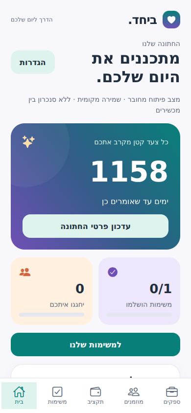

# ביחד · Beyachad

A private, Hebrew-first wedding planner for two partners. Expo SDK 58, React Native,
TypeScript and Expo Router. Version 0.6.0 adds a colorful shared design system,
accessible motion, an editable wedding/countdown dashboard, private documents,
password recovery and account departure/deletion to the existing planning modules.
Native delivery, hosted integrations and signed iPhone distribution still need acceptance.



## Run locally (Windows / macOS / Linux)

Install Node.js 24 LTS, then open this directory in a terminal:

```sh
npm ci
npm start
```

`npm start` opens a **development-only, automatically connected local workspace**.
It starts with empty names, no wedding date, no budget, and no tasks. The setup
screen creates the workspace on this device. Recommendations can be added to tasks.
`npm run web` opens the same shared application in a browser for development.
For production static hosting and iPhone home-screen setup, see [the web guide](docs/WEB-he.md).

SDK 58 requires a compatible Expo client. If the App Store Expo Go build does not
support it, use a development build. Face ID requires a native development build.

```sh
npx eas-cli@latest login
npx eas-cli@latest init
npx eas-cli@latest build --platform ios --profile development
```

The bundle identifiers in app.json are provisional. Choose identifiers under your
own Apple/Expo account before a signed build. EAS needs your Expo account and iOS
signing setup; no app was signed, uploaded or published by this deliverable.

## Real accounts and shared data

1. Create a Supabase project in your own account.
2. Run the SQL files in `supabase/migrations/` in filename order in its SQL editor.
   Existing installations run only migrations newer than those already applied.
   v0.5 needs migration 006; older versions apply all missing migrations in order.
3. Copy `.env.example` to `.env`. Set the project HTTPS URL and **publishable** key.
   Never use a service-role key or database password in the app.
4. Keep email confirmation enabled; configure the public Site URL / confirmation
   redirect in Supabase to a page you control. Users verify email in the browser,
   then return to the app and sign in using their password.
5. Run `npm run start:auth`. This disables the development session so you can test
   registration, sign-in, verification and session restoration.
6. Configure recovery emails to include the numeric `{{ .Token }}` in the Supabase
   **Reset Password** email template. The app uses email + recovery OTP, then a new
   password; it does not consume recovery links. Keep OTP expiry/rate limits enabled.
7. Deploy the document function as described below before testing cloud uploads.
8. Account A creates a wedding. In Settings, create an invitation code. Account B
   registers, signs in, selects Join wedding and enters the code. Each account can
   belong to one wedding, and each wedding has at most two accounts in this MVP.

The database uses RLS on all exposed tables. Wedding membership is created through
transactional RPCs only. Invitation tokens are 192-bit random values, stored as
SHA-256 hashes, expire after seven days and are consumed once. Generating a new
code invalidates the previous one. No message is sent automatically: sharing a
code uses the device share sheet when the user selects it.

Native auth tokens are stored in SecureStore, with chunked generation-based writes
to avoid large-value issues. Supabase refreshes access tokens using the refresh
session. Browser sessions persist in localStorage until sign-out or site-data removal. Passwords are never stored by
the app. Development data uses a separate local AsyncStorage key and never syncs
to the real backend.

Optional Face ID / Touch ID is a **local app lock after account authentication**,
not a replacement for server authentication or a passkey. Enable it in Settings
on a real account and a supported device. The app locks after backgrounding and
on restart; it does not expose the data provider while locked. Cancel/failure
keeps it locked. The fallback signs out locally and clears this device's biometric
preference, allowing a new password sign-in. Actual Face ID and Keychain lifecycle
behavior still need physical-device acceptance testing.

## What's implemented

- Generic setup with optional partner names, date and target budget.
- Login, registration, password confirmation and verification guidance.
- Persistent native sessions; development-only local auto-session.
- Wedding creation, single-use partner invitation and tenant isolation SQL.
- Home recommendations, live calendar-day countdown, progress indicators, upcoming tasks,
  meetings and payment shortcuts. Editable names/date use separate optimistic versions.
- Teal/purple/peach theme, branded icon, focus states, screen entrances, press springs,
  animated progress and tab/stack transitions; device/browser reduced-motion is respected.
- Recovery-code flow, new-password confirmation, local sign-out after reset.
- Explicitly confirmed departure/account deletion with shared-data retention and stable slots.
- Private PDF/JPEG/PNG documents, supplier/payment links, previews and confirmed deletion.
- Public privacy/help screen with release-operator details intentionally awaiting configuration.
- Full task creation, editing and confirmed deletion; stable partner assignment,
  status, priority, category, due date, notes, search, filters and sorting.
- Real-time task reloads and optimistic version checks to detect concurrent edits.
- Vendor cards: category, contact, quote, agreed price, status and notes.
- Budget target editing, commitments, paid totals, remaining/unallocated funds and overruns.
- Scheduled and paid payment records, including deposits, edited in place without duplication.
- Integer-agora arithmetic, stable operation IDs, transactional server validation and conflicts.
- Shared local storage updates preserve task and finance data together.
- Guest/family invitations with adult/child counts, partial RSVP, sides, groups, contact
  details, dietary notes and manual attendance tracking.
- Search/filters, invitation versus person totals, paged cloud loading and private access.
- Five functional navigation tabs plus protected editors and settings.
- Loading, error and retry states; drafts remain on concurrent-edit conflicts.

## Private document service and account lifecycle

Apply migration 006 after all previous migrations. It creates the private
`wedding-documents` bucket and metadata policies. Client keys can read only files
registered to their wedding, through signed URLs expiring after 60 seconds.
There is no client storage write/delete policy. Upload and removal go through:

```sh
npx supabase login
npx supabase functions deploy documents --project-ref YOUR_PROJECT_REF
```

Keep the platform JWT check enabled. The function also explicitly verifies the
Bearer token using Supabase Auth `getUser`, then verifies wedding membership.
Server-only `SUPABASE_URL` and `SUPABASE_SERVICE_ROLE_KEY` are supplied by the
Supabase hosted function runtime.
Never copy the server key into Expo public variables. Uploads use the server
identity so storage objects have no departing user's ownership. Registration locks
and rechecks membership and linked supplier/payment in PostgreSQL. A failed
registration attempts to remove the uploaded bytes; failed cleanup logs the path
for operator cleanup. Removal deletes Storage bytes before metadata and is retryable.

Files are limited to PDF, JPEG and PNG, 5 MiB each and 100 per wedding. Declared
MIME types and signatures are checked in client and server. Metadata writes are
service-only. In development, bytes stay in the local workspace (subject to local
storage quota), and never upload to the cloud. Native local previews use the share
sheet; Web previews use a sandboxed frame.

Leaving transfers ownership to the remaining member **without changing their
assignment slot**. Shared records and files remain with that member. The next
invite fills the vacant slot. Last-member departure deletes the wedding only after
all documents are removed through the app. Deleting an account also deletes its
Auth user. The UI requires typed confirmation and password verification for account
deletion; the RPC itself authorizes only the current authenticated account.
Membership removal immediately denies database/storage access, including for a
previously issued JWT. Already-issued signed document links last up to 60 seconds.

## Before public distribution

Complete [RELEASE-he.md](docs/RELEASE-he.md): provision your Supabase project,
configure recovery email and deploy the document function, test with two accounts
and physical iPhones, then configure your operator/support/privacy details and
Apple/Expo signing. The app has not been published or signed here. Public RSVP
links, seating, Excel import/export and guest messaging remain optional future scope.

## Sign-up button disabled?

The login/sign-up button is disabled when the app cannot read a usable Supabase
URL and public key. Password/email fields do not control this disabled state.
Place `.env` beside `package.json` (not `.env.txt`), and use these exact names:

```env
EXPO_PUBLIC_SUPABASE_URL=https://YOUR_PROJECT_REF.supabase.co
EXPO_PUBLIC_SUPABASE_PUBLISHABLE_KEY=YOUR_PUBLIC_KEY
```

`EXPO_PUBLIC_SUPABASE_ANON_KEY` is also accepted for legacy anon keys when the
publishable-key variable is empty. Bare `SUPABASE_URL`, `SUPABASE_ANON_KEY` and
`VITE_` names are not embedded by Expo. Whitespace around values is ignored.
Check the resolved files and missing variable names without printing key values:

```sh
npm run config:check
node scripts/start.mjs --auth --web --clear
```

The diagnostic follows Expo's development env-file precedence; pass
`npm run config:check -- --production` for production. The auth screen now shows
missing/invalid configuration directly above the form. This check validates local
configuration, not the project's network availability, key validity or signup policy.

## Checks

```sh
npm run check
npm run export:web
npx expo install --check
```

Core tests exercise release bypass protection, empty/default setup, date/budget
validation, stable recommendation IDs, secure token chunking, interrupted writes
and concurrent storage operations. Task tests cover assignment from both partner
viewpoints, local data upgrades, deadline handling, combined filters and stale
edits/deletions. PostgreSQL migration tests use PGlite to exercise constraints,
RLS and column privileges against a minimal v0.1 schema fixture. CI runs typecheck, lint, tests and web export.
Production export always disables development bypass. Release builds also have
`__DEV__ === false`, independently preventing the bypass even with a bad flag.

`eas.json` separates development (local demo), preview (real auth) and production
(real auth). Set public Supabase configuration for preview/production in EAS.
No Supabase or Apple account has been provisioned and no live auth/RLS or biometric
test is claimed without those accounts and devices.

## Git source

Canonical repository: https://github.com/OfirKadosh/Beyachad

```sh
git clone https://github.com/OfirKadosh/Beyachad.git
cd Beyachad
npm ci
npm start
```

The original ZIP also includes `beyachad-history.bundle` for offline restoration:
`git clone beyachad-history.bundle Beyachad`. To connect that restored checkout to
GitHub, replace its bundle-path origin with the canonical URL above.

See `docs/ACCEPTANCE.md` for the next validation steps.

## Finance upgrade (v0.3)

Apply migration 003 before connecting this app version to an existing v0.2 backend.
Fresh projects apply every migration in filename order. Development workspaces add
empty vendor/payment arrays on load; there is no reset or deletion of existing tasks.
Rebuild an installed development client after adding the native expo-crypto module.

All prices/payment amounts are stored as integer agorot. Only booked suppliers'
agreed prices count as commitments; unselected quotes are not added to the total.
Planned and paid entries are the same records with a payment date, so marking paid
never creates a second expense. Remaining to pay includes the scheduled portion.
Price reductions and unbooking are blocked if they conflict with allocated payment
records; a supplier with any payment records cannot be deleted until those records
are handled explicitly. This is tracking only, not payment processing or bank access.

Financial writes use membership-checked RPCs with vendor row locks and version
checks. Stable UUIDs make create retries idempotent. Authenticated clients have
read-only direct access to finance tables; all writes must use these RPCs.
Offline full editing and hosted cross-device acceptance remain separate work.

## Guest invitations (v0.4)

Apply `202611030004_guests_rsvp.sql` after migrations 001–003. Existing local data
adds an empty guest array without resetting tasks, suppliers, payments or budget.
A guest record is one invitation/family with separate invited and confirmed adult
and child counts. Pending invitations have no confirmed people. Confirmed families
may be partial; their unconfirmed people count as not attending. Therefore invited
people = confirmed + pending + not attending. Dietary notes belong to the whole
invitation and should specify quantities/people, not imply every family member.

Manual RSVP only: no guest-facing links or messages are sent. Stable wedding sides
remain consistent for both partners. Matching phone numbers trigger an advisory,
not automatic deduplication, because multiple invitations may share a contact.
RPC-only writes validate membership, counts and expected versions. Create retries
use stable IDs; contacts and dietary notes are protected by read RLS. Cloud loading
pages through visible rows so server row caps do not silently truncate totals.

The remaining first-release work and later extras are listed in `docs/ROADMAP-he.md`.

SDK 58 compatibility patches are aligned in v0.4. Rebuild an existing native
development client before the physical-device acceptance pass.

## Meetings and device reminders (v0.5)

Apply migration 005 after 001–004. Local workspaces add an empty meetings array;
existing tasks, guests, suppliers and payments remain intact. Meetings store a UTC
instant plus an explicit IANA time zone, duration, responsible partner(s), optional
supplier, status, location, notes and reminder lead time. Invalid or ambiguous wall
times at DST transitions are rejected instead of silently shifted. Deleting a supplier
unlinks its meeting and increments the meeting version; it does not delete history.

The in-app reminder center covers active assigned/shared meetings and tasks, and
shared unpaid installments. Date-only task/payment reminders use 09:00 in the
current device time zone; meeting reminders use the selected lead time. Overdue
items stay visible in-app. Past notification times are not delivered retroactively.

Install a new native development build after adding expo-notifications. The user
opts in on Reminders; no permission prompt is shown automatically. Web preview
uses only the in-app list and never requests browser push permission. Notifications
are local to this device, not server push, SMS, email or Calendar invitations.
The closest 50 future reminders are scheduled. Edits/completion/cancellation remove
or replace managed requests on sync, without touching other scheduled requests.
Generic lock-screen content contains no titles, contacts, amounts or location.
Logout/reset attempts to cancel managed requests; a biometric lock retains the
session and its generic reminders. Generation checks prevent queued stale schedules
from reappearing after logout. Permission revocation is surfaced rather than
reported as successful scheduling.

Keep the app open/reopen after changes on another device. Local reminders cannot
learn about remote edits while the app is fully closed; server delivery is future
work. Delivery is subject to OS permissions/settings and best-effort scheduling.
Physical iPhone permission, foreground/background, cold-launch, lock, sign-out,
clock/time-zone change and actual notification delivery still require acceptance.
No APNs/Expo push token or server credentials are collected by this implementation.

### Guest spreadsheets (v0.8.0)

Open Guests → Import/export. XLSX and UTF-8 CSV support shared preview,
column mapping, row exclusion, validation, duplicate skipping and additive
imports up to 500 invitations / 5 MB. Export all or the active guest filter,
or download an empty template. See [usage and limitations](docs/WEB-he.md).
SheetJS is pinned to the vendor's official 0.20.3 tarball.
Web downloads and native file sharing use platform adapters; no schema upgrade
or additional paid service is required. Existing native builds need rebuilding
if expo-sharing is not already included in the client.
